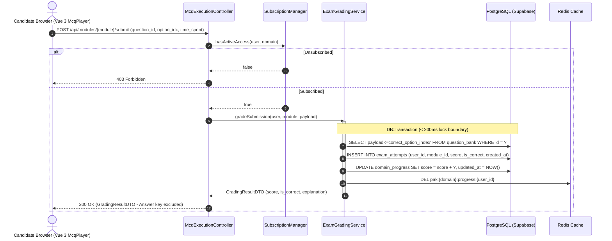
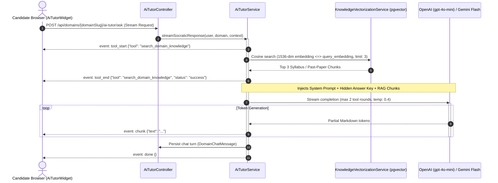
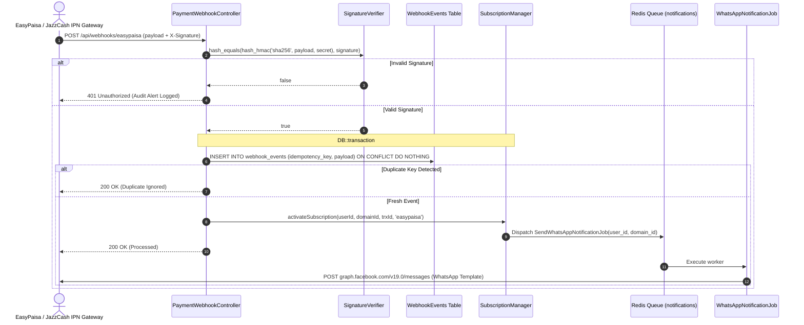
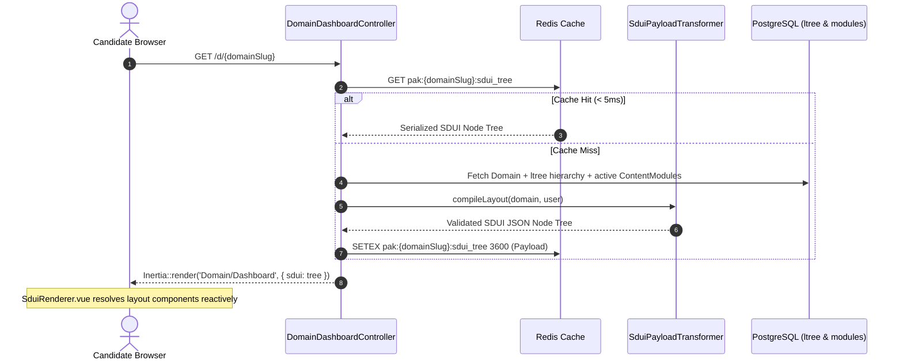

# .agent/ARCHITECTURE.md — System Blueprint & Reverse-Engineered Map

> **Status**: COMPLETE ARCHITECTURAL SPECIFICATION  
> **Application**: Pak-All-Tests (Competitive Examination & Intelligence Testing Engine)  
> **Platform Core**: Laravel 13+ Monolith • Inertia.js / Vue 3 • PostgreSQL 16+ (Supabase) • Filament 5

---

## 1. High-Level System Architecture

Pak-All-Tests is a high-performance examination preparation and testing platform engineered for competitive civil and military services (PMA Long Course, ISSB, CSS, PPSC, MDCAT). It combines:
1. **Server-Driven UI (SDUI)**: Dynamic dashboard layouts synthesized from PostgreSQL domain hierarchies and rendered reactively in Vue 3.
2. **Interactive MCQ & Subjective Testing**: Real-time timed assessment players with instantaneous scoring.
3. **AI Socratic Exam Mentor**: In-browser floating mentor backed by `pgvector` semantic knowledge search, strict tool calling limits, and Server-Sent Events (SSE).
4. **Subscription & Proof-of-Payment Gate**: Manual receipt verification workflow (Easypaisa, JazzCash, Bank Wire) tied to domain access gating.

```
[ Candidate Browser ]
        │
        ▼ (HTTPS / Cloudflare / Azure)
[ Nginx 1.28.0 (client_max_body_size: 64M) ]
        │
        ▼ (FastCGI: 127.0.0.1:9000)
[ PHP 8.4-FPM (upload_max_filesize: 64M) ]
        │
        ├──▶ [ Inertia.js + Vue 3 Frontend ] (SSR / SPA with Reka UI + Tailwind 4)
        │         ├── SduiRenderer.vue (Dynamic Layout Engine)
        │         ├── McqPlayer.vue & PdfViewer.vue
        │         └── AiTutorWidget.vue (SSE Streaming)
        │
        ├──▶ [ Filament Admin Panel (v5.0) ] (/admin)
        │         ├── Domains, Content Modules, Domain Flows, Question Banks
        │         └── User Subscriptions (Receipt Verification)
        │
        └──▶ [ Core Service Layer ]
                  ├── SubscriptionManager (Domain Access Gating)
                  ├── SduiPayloadTransformer & SduiSchemaValidator
                  ├── AiTutorService & AiCompletionService
                  └── KnowledgeVectorizationService (pgvector)
                           │
                           ▼
              [ PostgreSQL 16+ / Supabase ]
                ├── Extensions: ltree, vector(1536)
                └── Tables: domains, content_modules, question_bank,
                            user_subscriptions, domain_chat_messages,
                            domain_knowledge_embeddings
```

---

## 2. Directory Structure & Namespace Mapping

```
app/
├── Actions/                      # Atomic single-responsibility action classes
│   ├── Fortify/                  # CreateNewUser, ResetUserPassword, UpdateUserProfileInformation
│   └── Teams/                    # CreateTeam, DeleteTeam, UpdateTeamName
├── Auth/
│   └── CachingUserProvider.php   # Redis-backed User caching (bypasses remote DB round-trip)
├── Concerns/                     # Reusable Eloquent model & validation traits
│   ├── CachesTableData.php       # Automatic cache invalidation on table mutations
│   ├── HasTeams.php              # Multi-tenant team relationships & roles
│   ├── PasswordValidationRules.php
│   └── ProfileValidationRules.php
├── Console/Commands/
│   └── VectorizeKnowledgeCommand.php  # CLI Artisan tool to vectorize domain notes/questions
├── Data/                         # Spatie/DTO data transfer objects
│   ├── TeamPermissions.php
│   └── UserTeam.php
├── Enums/
│   ├── TeamPermission.php
│   └── TeamRole.php              # Owner, Admin, Member
├── Filament/                     # Filament Admin Panel v5
│   ├── Pages/
│   │   ├── SduiSchemaGuide.php   # Internal documentation for SDUI schema nodes
│   │   └── ImportQuestions.php   # Bulk JSON question import (nav group "Question Bank")
│   ├── Resources/
│   │   ├── ContentModules/       # ModuleResource, Form, Table, HandlesModuleFiles trait
│   │   ├── DomainFlows/          # DomainFlowResource, Form, Table
│   │   ├── Domains/              # DomainResource, Form, Table
│   │   ├── QuestionBanks/        # QuestionBankResource, Form, Table
│   │   └── UserSubscriptions/    # UserSubscriptionResource, Verification Form & Table
├── Http/
│   ├── Controllers/
│   │   ├── AiTutorController.php         # AI Socratic mentor SSE endpoint & history
│   │   ├── ContentModuleController.php   # JSON API to fetch module & eager-load questions
│   │   ├── DashboardController.php       # Team dashboard view
│   │   ├── DomainDashboardController.php # Candidate portal SDUI compiler & renderer
│   │   ├── McqExecutionController.php    # MCQ answer evaluation & score calculation
│   │   ├── SubscriptionReceiptController.php # Proof-of-payment upload handler
│   │   ├── Settings/                     # ProfileController, SecurityController
│   │   └── Teams/                        # TeamController, TeamMemberController, TeamInvitationController
│   ├── Middleware/
│   │   ├── EnsureTeamMembership.php      # Team access guard
│   │   ├── HandleAppearance.php          # Dark/light theme cookie reader
│   │   ├── HandleInertiaRequests.php      # Global Inertia shared props (auth, teams, flash)
│   │   └── SetTeamUrlDefaults.php        # Default team slug injector for routes
│   ├── Requests/
│   │   ├── Settings/ProfileUpdateRequest.php
│   │   └── Teams/ (InviteTeamMemberRequest, UpdateTeamMemberRequest, UpdateTeamNameRequest)
│   └── Responses/                        # Fortify custom authentication responses
│       ├── LoginResponse.php             # Redirects candidate to /#exams
│       ├── RegisterResponse.php          # Redirects candidate to /#exams
│       ├── PasskeyLoginResponse.php
│       ├── TwoFactorLoginResponse.php
│       ├── VerifyEmailResponse.php
│       └── Concerns/RedirectsToCurrentTeam.php # Safe team-agnostic URL resolver
├── Actions/
│   └── QuestionBank/
│       └── StoreGeneratedQuestionsAction.php # Atomic bulk question persistence, mcq/short_answer types, dry-run preview
├── Jobs/
│   ├── ImportQuestionsJob.php            # Queued bulk question import: per-subject modules, batched inserts, cached report
│   └── VectorizeDomainKnowledgeJob.php   # Queued vectorization for pgvector embeddings
├── Models/                               # Eloquent Models (detailed in section 3)
├── Policies/
│   └── TeamPolicy.php
├── Providers/
│   ├── AppServiceProvider.php            # Performance logging, Redis cache provider, URL forceScheme
│   ├── FortifyServiceProvider.php        # Rate limiting, Auth views, Actions configuration
│   └── Filament/AdminPanelProvider.php   # Filament admin configuration & themes
├── Rules/
│   └── TeamName.php
└── Services/
    ├── SubscriptionManager.php           # Access gating logic based on user_subscriptions
    ├── SduiPayloadTransformer.php        # Transforms domain hierarchy into SDUI node tree
    ├── SduiSchemaValidator.php           # Strict validator for SDUI component schemas
    └── Ai/
        ├── AiCompletionService.php       # Multi-driver LLM caller (OpenAI / Gemini / Fake)
        ├── AiTutorService.php            # Socratic mentor execution loop & tool routing
        ├── EmbeddingService.php          # Vector(1536) embedding client
        ├── KnowledgeVectorizationService.php # RAG indexing pipeline for questions & notes
        └── McqGeneratorService.php       # Pure-PHP parser & batched AI distractor engine
```


---

## 3. Database Schema & Eloquent Models

### Database Extensions
- **`ltree`**: PostgreSQL extension for infinite hierarchical path structures (used in category / syllabus trees).
- **`vector` (`pgvector`)**: Stores 1536-dimensional HNSW cosine embeddings for semantic search.

### Core Models & Relationships

| Model | Table | Key Attributes / Columns | Relationships |
| :--- | :--- | :--- | :--- |
| **`User`** | `users` | `name`, `email`, `password`, `current_team_id` | `subscriptions()`, `subscribedDomains()`, `teams()`, `ownedTeams()` |
| **`Domain`** | `domains` | `name`, `slug`, `code`, `is_active`, `path` (`ltree`), `description` | `contentModules()`, `flows()`, `knowledgeEmbeddings()` |
| **`ContentModule`**| `content_modules`| `domain_id`, `title`, `slug`, `module_type` (preparation/mock_test/pdf_repo), `sort_order`, `content_meta` (`jsonb`) | `belongsTo(Domain)`, `belongsToMany(QuestionBank)` |
| **`QuestionBank`** | `question_bank` | `code`, `question_text`, `question_type` (mcq/subjective), `difficulty_level`, `payload` (`jsonb`), `is_active` | `belongsToMany(ContentModule)` via `module_questions` |
| **`UserSubscription`**| `user_subscriptions`| `user_id`, `domain_id`, `status` (active/pending/rejected/expired), `payment_method`, `receipt_url`, `starts_at`, `expires_at` | `belongsTo(User)`, `belongsTo(Domain)` |
| **`DomainFlow`** | `domain_flows` | `domain_id`, `title`, `slug`, `sort_order`, `prerequisites` (`jsonb`), `is_active` | `belongsTo(Domain)` |
| **`DomainChatMessage`**| `domain_chat_messages`| `domain_id`, `user_id`, `role` (user/assistant), `content`, `context_metadata` (`jsonb`) | `belongsTo(Domain)`, `belongsTo(User)` |
| **`DomainKnowledgeEmbedding`**| `domain_knowledge_embeddings`| `domain_id`, `content_module_id`, `title`, `content`, `embedding` (`vector(1536)`), `metadata` (`jsonb`) | `belongsTo(Domain)`, `belongsTo(ContentModule)` |
| **`Team`** | `teams` | `name`, `slug`, `is_personal` | `members()`, `invitations()`, `owner()` |
| **`Membership`** | `team_members` | `team_id`, `user_id`, `role` (owner/admin/member) | `belongsTo(Team)`, `belongsTo(User)` |

---

## 4. Frontend Architecture (Vue 3 + Inertia + SDUI)

1. **Server-Driven UI (SDUI) Engine**:
   - `DomainDashboardController` calls `SduiPayloadTransformer` to compile a complete tree of UI nodes.
   - [resources/js/components/sdui/SduiRenderer.vue](file:///resources/js/components/sdui/SduiRenderer.vue) recursively traverses the node tree and resolves components via [componentRegistry.js](file:///resources/js/components/sdui/componentRegistry.js).
   - Registered layouts: `VerticalStack`, `TabbedLayout`, `PhaseStepperLayout`, `SubjectGrid`, `ProgressCard`, `ResourceList`, `EmptyStateLayout`.
2. **Assessment Execution**:
   - `McqPlayer.vue`: Interactive timed question player with immediate feedback, pattern breakdown, and answer submission to `/api/modules/{module}/submit`.
   - `PdfViewer.vue`: Fullscreen PDF viewer supporting `/storage/...` documents and Google Drive previews.
   - `SubjectiveUpload.vue`: Subjective word-association and situation-reaction input with real-time character counters.
3. **AI Socratic Tutor Widget**:
   - [resources/js/components/ai/AiTutorWidget.vue](file:///resources/js/components/ai/AiTutorWidget.vue): Floating action trigger + slide-over drawer.
   - Streams responses via Server-Sent Events (`POST /api/domains/{domainSlug}/ai-tutor/ask`).
   - Renders clean Markdown and communicates with the Socratic hint engine.

---

## 5. Security, Gating & Environment Constraints

1. **Subscription Gating (`SubscriptionManager`)**:
   - Access to `/d/{domainSlug}` and `/api/modules/{module}` is gated strictly by `SubscriptionManager::hasActiveAccess($user, $domain)`.
   - If unsubscribed, the user is redirected to `/d/{domainSlug}` which renders `Subscription/PendingOrInactive.vue`.
2. **Reverse Proxy & SSL**:
   - Configured with `$middleware->trustProxies(at: '*')` in `bootstrap/app.php` and `URL::forceScheme('https')` in `AppServiceProvider.php` for Azure/Cloudflare edge SSL termination.
3. **File Upload Limits**:
   - Synchronized across Nginx (`client_max_body_size 64M;` in `default`) and PHP-FPM (`upload_max_filesize = 64M`, `post_max_size = 64M` in `uploads.ini`).

---

## 6. Sub-Architectural Rule Index (`.agent/rules/`)

This architecture is governed by cross-cutting principles in [`.agent/SYSTEM_RULES.md`](file:///.agent/SYSTEM_RULES.md), visual rules in [`.agent/UI_REFERENCE.md`](file:///.agent/UI_REFERENCE.md), and 12 detailed sub-architectural specifications located in [`.agent/rules/`](file:///.agent/rules/):

| Rule File | Scope & Mandatory Standards |
| :--- | :--- |
| [`.agent/SYSTEM_RULES.md`](file:///.agent/SYSTEM_RULES.md) | Persona, Radical simplicity (YAGNI), zero assumptions, clean code hygiene, battle-scarred reflexes, pure JavaScript in Vue (`<script setup>`). |
| [`.agent/UI_REFERENCE.md`](file:///.agent/UI_REFERENCE.md) | Design token memory, provisional palettes, typography, and reference screenshot registry. |
| [`.agent/rules/ui_design.md`](file:///.agent/rules/ui_design.md) | Academic Rigor & Military Precision tone, Anti-AI visual laws, no dead clicks, mathematical nested radius formula ($R_{\text{inner}} = \max(0, R_{\text{outer}} - P)$). |
| [`.agent/rules/ai_tutor.md`](file:///.agent/rules/ai_tutor.md) | Socratic AI Tutor SSE streaming, intent routing, tool calling limits (max 2 rounds), zero correct answer leakage, PMA/ISSB/CSS/MDCAT institutional domain standards. |
| [`.agent/rules/user_subscriptions.md`](file:///.agent/rules/user_subscriptions.md) | EasyPaisa / JazzCash / Bank Transfer payment state machine (`pending` $\rightarrow$ `active`/`rejected`/`expired`), WhatsApp Cloud API notifications. |
| [`.agent/rules/domains.md`](file:///.agent/rules/domains.md) | PostgreSQL `ltree` path format, GiST index, sub-millisecond tree updates, Redis caching hooks. |
| [`.agent/rules/domain_flows.md`](file:///.agent/rules/domain_flows.md) | Multi-phase exam workflows, prerequisites dependency evaluation, SDUI phase stepper synthesis. |
| [`.agent/rules/content_modules.md`](file:///.agent/rules/content_modules.md) | Content module polymorphic types (`mcq_test`, `pdf_resource`, `subjective_prompt`), resource linkage, file handling. |
| [`.agent/rules/question_bank.md`](file:///.agent/rules/question_bank.md) | Question schema, JSONB options, answer-key scrubbing, pgvector semantic search embedding storage. |
| [`.agent/rules/database_performance.md`](file:///.agent/rules/database_performance.md) | Sub-millisecond queries, single round-trip query batching, indexing strategies, zero N+1, Sub-200ms transaction law, Cache-Pointer pattern. |
| [`.agent/rules/security_gating.md`](file:///.agent/rules/security_gating.md) | Controller-level `SubscriptionManager` gating, Fortify auth, tenant isolation, CSRF protection. |
| [`.agent/rules/testing_validation.md`](file:///.agent/rules/testing_validation.md) | Pest test suite execution, `DatabaseTransactions` (banning `migrate:fresh` in tests), zero dynamic properties. |
| [`.agent/rules/sdui_blueprints.md`](file:///.agent/rules/sdui_blueprints.md) | SDUI JSON schema definitions, component registry contracts, server-side layout compilation. |
| [`.agent/rules/mistakes.md`](file:///.agent/rules/mistakes.md) | Catalog of 11 known engineering pitfalls and historical root-cause analyses (RCA). |

---

## 7. Critical Path Data Flow Diagrams

### A. MCQ Submission, Server-Side Grading & Progress Mutation


### B. Socratic AI Tutor SSE Streaming & RAG Pipeline


### C. Manual & Webhook Proof-of-Payment Verification Pipeline


### D. SDUI Page Compilation, Caching & Reactive Rendering


---

### E. Bulk Question Import Pipeline (Filament Admin)
```mermaid
sequenceDiagram
    autonumber
    actor Admin as Admin (Filament)
    participant Page as ImportQuestions Page
    participant Job as ImportQuestionsJob (queued)
    participant Act as StoreGeneratedQuestionsAction
    participant DB as PostgreSQL (Supabase)
    participant Cache as Cache (report)

    Admin->>Page: Upload JSON + Start Import (dry_run?)
    Page->>Page: validatePayload (subjects map + questions array)
    alt Dry Run
        Page->>Job: dispatchSync
        Job->>Act: execute(dryRun: true) per 50-item subject batch
        Note over Act,DB: Read-only hash dedup against question_bank;<br/>no writes, no pivot attach, no vectorization
        Job->>Cache: PUT question_import_report_{uuid} (600s TTL)
        Page-->>Admin: Preview notification + per-subject report table
    else Live Run
        Page->>Job: dispatch (async)
        Job->>DB: firstOrCreate per-subject preparation modules (flat, under domain)
        Job->>Act: execute() per 50-item subject batch
        Note over Act,DB: DB::transaction (< 200ms lock boundary);<br/>bulk insert + insertOrIgnore pivots
        Job->>Cache: PUT question_import_report_{uuid} (600s TTL)
        Job-->>Admin: Filament database notification (inserted / skipped / invalid)
    end
```

## 8. Caching Layers & Invalidation Contract

To guarantee sub-10ms UI renders and protect remote PostgreSQL connection limits, the application enforces a strict multi-tier caching hierarchy:

| Cache Item | Storage Driver | Cache Key Pattern | TTL | Invalidation Trigger | Concurrency / Stampede Defense |
| :--- | :--- | :--- | :--- | :--- | :--- |
| **Compiled SDUI Layouts** | Redis | `pak:{domainSlug}:sdui:v1` | 3,600s (1 hr) | `ContentModule::saved()`, `DomainFlow::saved()` via `CachesTableData` | Redis atomic lock `lock:sdui:{domainSlug}` (10s lock) |
| **Domain Category Tree** | Redis | `pak:domain_tree:hierarchy` | 86,400s (24 hr)| `Domain::created()`, `Domain::updated()`, `Domain::deleted()` | Pre-warmed on deployment via `VectorizeKnowledgeCommand` |
| **User Active Subscriptions**| Redis | `pak:user:{userId}:subs` | 1,800s (30 min)| `SubscriptionManager::activate()`, `expire()`, `reject()` | Direct cache bust (`Cache::forget()`) inside mutation transaction |
| **Candidate Exam Progress** | Redis | `pak:{domainSlug}:prog:{userId}`| 600s (10 min) | `ExamGradingService::gradeSubmission()` completion | Direct cache bust on grading transaction commit |
| **Embeddings Count / Meta** | Redis | `pak:domain:{domainId}:emb_meta`| 3,600s (1 hr) | `KnowledgeVectorizationService::indexQuestion()` | Atomic counter increment (`Redis::incr()`) |
| **Bulk Import Batch Pointers**| Redis | `import_batch:{uuid}` | 1,800s (30 min)| Filament modal confirm or modal cancel | Cache pointer destroyed upon successful database persistence |

---

## 9. Asynchronous Queue Architecture & Worker Pools

To prevent high-latency operations (RAG embedding generation, AI distractor drafting, external WhatsApp calls) from blocking critical candidate-facing workflows, workers are partitioned across dedicated queues:

```
[ RabbitMQ / Redis Driver ]
       ├── Queue: high_priority (MCQ evaluation, Auth tokens, Passkey verification)
       ├── Queue: receipts       (Manual payment slip processing & OCR triage)
       ├── Queue: notifications  (WhatsApp Cloud API & transactional SMS)
       ├── Queue: mcq_generation (AI Distractor generation & bulk file ingestion)
       └── Queue: rag_indexing   (pgvector 1536-dim embedding generation & sync)
```

| Queue Name | Priority | Concurrency / Workers | Retry Policy | Backoff Strategy | DLQ Destination | Poison-Pill Handling |
| :--- | :--- | :--- | :--- | :--- | :--- | :--- |
| **`high_priority`** | 1 (Max) | 4 Dedicated Workers | 3 Tries | Exponential: 2s, 5s, 10s | `failed_jobs` table | Discard after 3 attempts; log emergency Sentry event |
| **`receipts`** | 2 | 2 Dedicated Workers | 3 Tries | Exponential: 5s, 15s, 30s | `receipts_dlq` | Mark subscription `review_required`, alert admin in Filament |
| **`notifications`** | 3 | 2 Dedicated Workers | 5 Tries | Jittered: 5s, 30s, 120s, 300s | `notifications_dlq` | Fall back to transactional email if WhatsApp fails after 5 tries |
| **`mcq_generation`** | 4 | 2 Dedicated Workers | 2 Tries | Linear: 10s, 30s | `generation_dlq` | Store partial progress; notify author with `unparsed_lines` |
| **`rag_indexing`** | 5 (Low) | 1 Dedicated Worker | 3 Tries | Exponential: 10s, 60s, 180s | `indexing_dlq` | Mark record `vectorization_failed`; re-run via nocturnal cron |

**Mandatory Isolation Rule**: AI RAG embeddings and WhatsApp notifications MUST NEVER share a queue with candidate exam scoring. A spike in batch past-paper imports must never introduce a 1-second delay into candidate test submissions.

---

## 10. External Integration Resilience & Circuit Breakers

Every outbound third-party call is guarded by strict timeouts, retries, and circuit breakers:

| External Provider | Scope / Endpoint | HTTP Timeout | Retries | Circuit Breaker Threshold | Fallback Behavior | Failure Telemetry |
| :--- | :--- | :--- | :--- | :--- | :--- | :--- |
| **OpenAI / Gemini** | Chat completions & SSE (`POST /chat/completions`) | 15s (Connect: 2s) | 2 Tries | 5 consecutive failures in 60s $\rightarrow$ Open 5m | Degrade to Socratic static hint bank or rule-based hints | Emit `ai.provider_down` to Datadog/Sentry; increment failure metric |
| **Meta WhatsApp Cloud**| Candidate notifications (`POST /v19.0/{phone_id}/messages`)| 4s (Connect: 1s) | 3 Tries | 10 failures in 120s $\rightarrow$ Open 10m | Queue email notification via standard SMTP | Log `notification.whatsapp_failed` with provider response code |
| **EasyPaisa IPN** | Merchant payment verification (`POST /ipn`) | 5s (Connect: 2s) | 3 Tries | 5 failures in 60s $\rightarrow$ Open 5m | Mark transaction `pending_manual_verification` in Filament | Alert on-call via Slack webhook: `payment.gateway_unreachable` |
| **JazzCash IPN** | Merchant payment verification (`POST /ipn`) | 5s (Connect: 2s) | 3 Tries | 5 failures in 60s $\rightarrow$ Open 5m | Mark transaction `pending_manual_verification` in Filament | Alert on-call via Slack webhook: `payment.gateway_unreachable` |
| **Google Drive PDF** | Document preview & embedding iframe | 5s (Connect: 2s) | 1 Try | 5 failures in 60s $\rightarrow$ Open 5m | Serve locally cached PDF from `/storage` disk directly | Log `storage.drive_preview_failed` |

---

## 11. Security Architecture & Boundary Isolation

### A. Attack-Surface Map & Route Segregation
1. **Public Attack Surface** (`/`, `/#exams`, `/login`, `/register`, `/api/health`):
   - Strict rate limiting: `throttle:60,1` per IP.
   - Zero access to exam questions, answer keys, or candidate data.
2. **Candidate Portal (`/d/{domainSlug}`, `/api/modules/...`)**:
   - Gated by `auth:sanctum` or Fortify session + `EnsureActiveSubscription` middleware.
   - IDOR Defense: Direct parameter lookups forbidden. All resources resolved via `user->subscribedDomains()`.
3. **Administrative Surface (`/admin`)**:
   - Scoped to Filament admin guard. Requires multi-tenant membership check (`EnsureTeamMembership`).
   - 2FA and passkey hardware token enforcement for staff accounts.
4. **Ingestion & Webhook Surface (`/api/webhooks/...`)**:
   - Signature-verified via `hash_hmac('sha256', ...)`. Rejects untrusted payloads before Laravel request routing.

### B. Session & Token Lifecycle
- **Session Expiry**: 120 minutes of inactivity; hard session regeneration on privilege escalation or team switch.
- **Passkey & 2FA Recovery**: WebAuthn challenge TTL capped at 60 seconds; recovery codes stored as bcrypt hashes.
- **Password Reset Tokens**: Strict 15-minute TTL enforced in `config/auth.php`.

### C. Tenant & Domain Isolation Guarantee
- **PostgreSQL `ltree` Domain Hierarchies**: Candidate access to a parent domain (e.g. `armed_forces.army.pma`) cascades strictly downwards; sibling domains (e.g. `civil_services.css`) are strictly partitioned.
- **Answer Key Zero-Knowledge Principle**: The Vue frontend bundle, Inertia props, and network payloads NEVER receive `correct_option_index` or answer letters during an active test session. Answers are evaluated strictly inside backend transaction memory.

---

## 12. Scalability Roadmap & Breakpoint Thresholds

| Concurrent Candidate Takers | System Bottleneck / Breakpoint | Mandated Escape Hatch / Architecture Shift |
| :--- | :--- | :--- |
| **1 – 500** | Supabase connection pooling (port 6543 PgBouncer limits). | Current architecture: Single monolith + PgBouncer + Redis caching. |
| **500 – 2,500** | Database read contention on `question_bank` and SDUI layout fetches. | Deploy PostgreSQL read replica for SDUI layout fetches & question reads; write transactions remain on primary. |
| **2,500 – 10,000** | SSE connection exhaustion on PHP-FPM web workers. | Extract Socratic AI SSE streaming to standalone Node.js / Go lightweight gateway or Laravel Octane (Swoole). |
| **10,000 – 50,000**| Vector search latency degradation on monolithic table. | Partition `domain_knowledge_embeddings` table by `domain_id` using PostgreSQL declarative table partitioning. |
| **50,000+** | Simultaneous nationwide exam submission spikes (e.g. MDCAT / PMA mock test release). | Decouple grading: Submissions write raw JSON payload to Kafka / Amazon SQS; asynchronous grading workers drain queue. |

---

## 13. Data Lifecycle, Retention & Compliance

### A. Retention Policies
- **Domain Chat Messages (`domain_chat_messages`)**: Retained for 90 days following candidate exam completion; purged via automated nocturnal job (`PurgeOldChatMessagesCommand`).
- **Payment Verification Receipts (`user_subscriptions.receipt_url`)**: Retained for 365 days on encrypted private S3/local disk for tax audit compliance; soft-deleted thereafter.
- **Exam Attempt Records (`exam_attempts`)**: Retained indefinitely in aggregated format; question-by-question response breakdown pruned to compressed JSON after 180 days.
- **Vector Embeddings (`domain_knowledge_embeddings`)**: Re-indexed whenever underlying syllabus nodes are updated; orphaned embeddings purged immediately on parent module deletion.

### B. Soft-Delete vs Hard-Delete Decisions
- **`User` / `UserSubscription`**: **Strict Soft Deletes** (`SoftDeletes` trait). Financial auditing, payment tracing, and exam certification validity prohibit physical record deletion.
- **`QuestionBank`**: **Soft Deletes**. Questions referenced by past exam attempts must retain historical referential integrity.
- **`DomainChatMessage`**: **Hard Deletes**. Chat turns contain transient learning interactions; physical deletion enforces candidate privacy minimization.

### C. PII Classification & Minimization
- **High-Risk PII**: Passwords (argon2id), Passkey WebAuthn Public Keys, CNIC numbers (encrypted with `Crypt::encryptString`).
- **Operational PII**: Mobile phone numbers, candidate full names, transaction receipt images. Restricted to admin Filament tenant roles.
- **Anonymized Data**: Performance metrics, question difficulty stats, topic accuracy scores. Stripped of user identifiers for institutional reporting.


