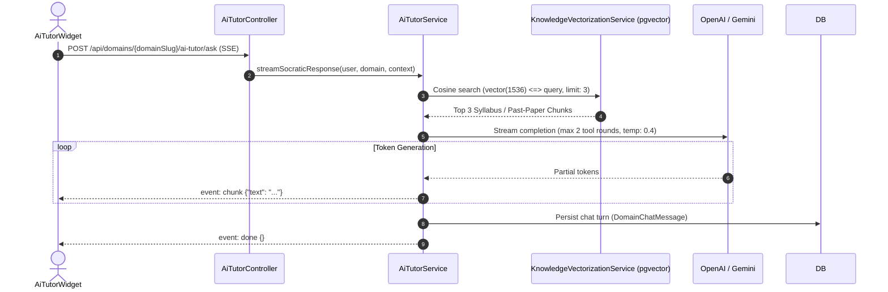
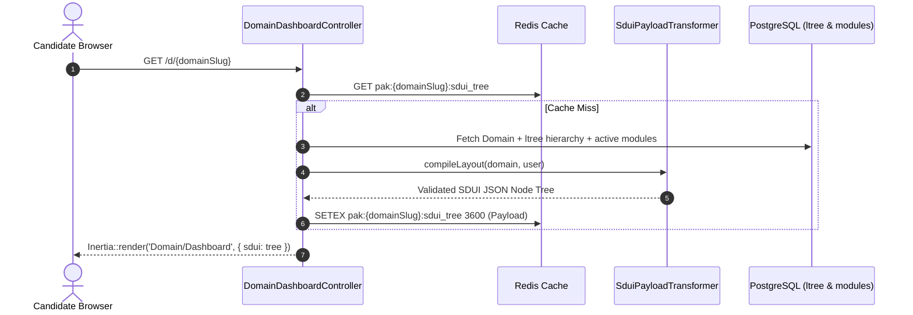
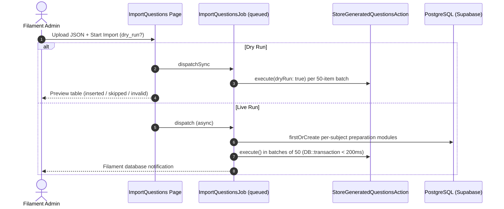

# .agent/ARCHITECTURE.md — System Blueprint & Reverse-Engineered Map

> **Status**: COMPLETE ARCHITECTURAL SPECIFICATION  
> **Application**: Pak-All-Tests (Competitive Examination & Intelligence Testing Engine)  
> **Platform Core**: Laravel 13+ Monolith • Inertia.js / Vue 3 • PostgreSQL 16+ (Supabase) • Filament 5

---

## 1. High-Level System Architecture

Pak-All-Tests is a high-performance examination preparation and testing platform for competitive civil and military services (PMA Long Course, ISSB, CSS, PPSC, MDCAT).

```
[ Candidate Browser (Vue 3 / Inertia) ]
         │
         ▼ (HTTPS / Cloudflare / Azure SSL Termination)
[ Nginx 1.28.0 (client_max_body_size: 64M) ]
         │
         ▼ (FastCGI: 127.0.0.1:9000)
[ PHP 8.4-FPM (upload_max_filesize: 64M) ]
         │
         ├──▶ [ Inertia.js + Vue 3 Frontend ] (SduiRenderer, McqPlayer, AiTutorWidget)
         ├──▶ [ Filament Admin Panel v5 ] (/admin: Domains, Modules, Questions, Subscriptions)
         └──▶ [ Core Service Layer ] (SubscriptionManager, SduiPayloadTransformer, AiTutorService)
                   │
                   ▼
         [ PostgreSQL 16+ / Supabase (PgBouncer port 6543) ]
           ├── Extensions: ltree (hierarchies), vector(1536) (semantic search)
           └── Tables: domains, content_modules, question_bank, user_subscriptions,
                       user_weak_questions, domain_knowledge_embeddings
```

---

## 2. Directory Structure & Namespace Mapping

```
app/
├── Actions/
│   ├── Fortify/                  # Auth actions: CreateNewUser, ResetUserPassword, UpdateProfile
│   ├── QuestionBank/             # StoreGeneratedQuestionsAction, SubjectModuleProvisioner
│   └── Teams/                    # Team lifecycle: CreateTeam, DeleteTeam, UpdateTeamName
├── Auth/CachingUserProvider.php  # Redis-backed User caching (bypasses remote DB on auth check)
├── Concerns/                     # CachesTableData, HasTeams, PasswordValidationRules
├── Filament/                     # Admin v5: SduiSchemaGuide, ImportQuestions, Domain/Module/Question resources
├── Http/
│   ├── Controllers/              # Thin controllers: AiTutor, ContentModule, DomainDashboard,
│   │                             # McqExecution, SubscriptionReceipt, WeakQuestions, Settings, Teams
│   ├── Middleware/               # EnsureTeamMembership, HandleAppearance, HandleInertiaRequests
│   └── Responses/                # Fortify custom responses (redirects candidates to /#exams)
├── Jobs/                         # ImportQuestionsJob, LinkPmaSubjectModulesJob, VectorizeDomainKnowledgeJob
├── Models/                       # Domain, ContentModule, QuestionBank, User, UserSubscription, UserWeakQuestion, Referral, PlatformSetting
├── Policies/                     # TeamPolicy
├── Providers/                    # AppServiceProvider, FortifyServiceProvider, Filament/AdminPanelProvider
└── Services/
    ├── SubscriptionManager.php   # Central access gating via user_subscriptions state machine & free bypass toggles
    ├── GuestAuthService.php      # 24h ephemeral guest passes with non-destructive permanent account conversion
    ├── ReferralService.php       # Viral referral ladder (+7 days, 30 days at 5), abuse detection, anti-fraud
    ├── SduiPayloadTransformer.php# Transforms domain hierarchy into SDUI node tree
    ├── SduiSchemaValidator.php   # Validates SDUI component schema payloads
    └── Ai/                       # AiCompletionService, AiTutorService (SSE), EmbeddingService,
                                  # KnowledgeVectorizationService (pgvector), McqGeneratorService
```

---

## 3. Database Schema & Eloquent Models

- **Extensions**: `ltree` (unlimited category/syllabus tree paths), `vector(1536)` (HNSW cosine embeddings).

| Model | Table | Key Columns | Relationships |
| :--- | :--- | :--- | :--- |
| **`User`** | `users` | `name`, `email`, `password`, `is_guest`, `guest_expires_at`, `guest_token_hash`, `last_active_at`, `is_suspended`, `suspension_reason`, `referral_code`, `referred_by_id`, `registration_ip` | `subscriptions()`, `subscribedDomains()`, `teams()`, `referralsGiven()`, `referralsReceived()`, `referrer()` |
| **`Domain`** | `domains` | `name`, `slug`, `code`, `is_active`, `requires_subscription`, `path` (`ltree`) | `contentModules()`, `flows()`, `knowledgeEmbeddings()`, `referrals()` |
| **`Referral`** | `referrals` | `referrer_id`, `referred_user_id`, `domain_id`, `referral_code`, `reward_days`, `status` (pending/approved/rejected/flagged_abuse), `abuse_reason`, `ip_address`, `device_fingerprint` | `belongsTo(User, 'referrer_id')`, `belongsTo(User, 'referred_user_id')`, `belongsTo(Domain)` |
| **`PlatformSetting`** | `platform_settings` | `key`, `value` | Key-value application runtime config store with cache-busting |
| **`ContentModule`** | `content_modules` | `domain_id`, `title`, `slug`, `module_type`, `sort_order`, `dashboard_section`, `display_mode` | `belongsTo(Domain)`, `belongsToMany(QuestionBank)` |
| **`QuestionBank`** | `question_bank` | `code`, `question_text`, `question_type`, `payload` (`jsonb`), `is_active` | `belongsToMany(ContentModule)` via `module_questions` |
| **`UserSubscription`** | `user_subscriptions` | `user_id`, `domain_id`, `status` (active/pending/rejected/expired), `receipt_url`, `payment_method` | `belongsTo(User)`, `belongsTo(Domain)` |
| **`UserWeakQuestion`** | `user_weak_questions` | `user_id`, `question_id`, `domain_id`, `consecutive_correct`, `status` (active/mastered) | `belongsTo(User)`, `belongsTo(QuestionBank)` |
| **`DomainFlow`** | `domain_flows` | `domain_id`, `title`, `slug`, `sort_order`, `prerequisites` (`jsonb`), `is_active` | `belongsTo(Domain)` |
| **`DomainChatMessage`** | `domain_chat_messages` | `domain_id`, `user_id`, `role`, `content`, `context_metadata` (`jsonb`) | `belongsTo(Domain)`, `belongsTo(User)` |
| **`DomainKnowledgeEmbedding`** | `domain_knowledge_embeddings` | `domain_id`, `content_module_id`, `title`, `embedding` (`vector(1536)`) | `belongsTo(Domain)`, `belongsTo(ContentModule)` |
| **`Team`** / **`Membership`** | `teams` / `team_members` | `name`, `slug`, `is_personal` / `team_id`, `user_id`, `role` | Multi-tenant team relationships |

### Notification Storage
- **`notifications`** (no app Eloquent model; Laravel `DatabaseNotification`): `id` (uuid PK), `type`, `notifiable_type`/`notifiable_id` (`morphs`), `data` (`text`), `read_at` (nullable), timestamps. Backs Filament `Notification::sendToDatabase()` used by the bulk import and link-repair jobs. Table added 2026-10-04 (`2026_10_04_000002_create_notifications_table`) — it never existed before, which crashed import dry runs with `SQLSTATE[42P01]`; both jobs now also guard the send with try/catch so a notification failure can never fail the report.

---

## 4. Frontend Architecture (Vue 3 + Inertia + SDUI)

1. **SDUI Engine**:
   - `DomainDashboardController` invokes `SduiPayloadTransformer` to compile UI node trees.
   - [resources/js/components/sdui/SduiRenderer.vue](file:///resources/js/components/sdui/SduiRenderer.vue) recursively resolves components via [componentRegistry.js](file:///resources/js/components/sdui/componentRegistry.js).
   - Layouts: `VerticalStack`, `TabbedLayout`, `PhaseStepperLayout`, `SubjectGrid`, `ProgressCard`, `ResourceList`, `EmptyStateLayout` (SenseLab design with mesh auras, nested radii, tactile controls).
2. **Candidate Workspace**:
   - `McqPlayer.vue`: Interactive timed test engine with dual view modes (Page View with 10/25/50/100 pagination vs Focus Mode), Reveal Answer forfeiture, and submission to `/api/modules/{module}/submit`.
   - `StudyQaPlayer.vue`: Dedicated study reader and interactive accordion for non-MCQ study modules (e.g. Physical/Medical criteria, interview questions), featuring real-time client search, expand/collapse all, and zero forfeiture/test penalties.
   - `WeakQuestions/Index.vue`: Targeted revision portal with subject filters, 2-strike mastery metrics, and direct practice launcher.
   - `Dashboard.vue`: SenseLab Candidate Command Center with active exam tracks and interactive curriculum topology.
3. **AI Socratic Tutor**:
   - [resources/js/components/ai/AiTutorWidget.vue](file:///resources/js/components/ai/AiTutorWidget.vue): Draggable floating FAB with pointer capture, touch/mouse resize handles, and SSE streaming (`POST /api/domains/{domainSlug}/ai-tutor/ask`).

---

## 5. Security, Gating & Environment Constraints

1. **Subscription Gating (`SubscriptionManager`)**: Access to `/d/{domainSlug}` and `/api/modules/{module}` is strictly gated via `SubscriptionManager::hasActiveAccess($user, $domain)`. Unsubscribed users receive `Subscription/PendingOrInactive.vue`.
2. **Frictionless Candidate Auto-Guest Access & Dual-Anchor Deduplication (`AutoAuthenticateGuest`)**: Direct visits to student learning routes (`/d/{domainSlug}`, `/dashboard`, `/revision-weak-questions`) automatically provision or re-authenticate an ephemeral guest user with 24 hours of trial access via `GuestAuthService::getOrCreateGuestUser`. Uses a Dual-Anchor identity resolution: primary 30-day HttpOnly device cookie (`pak_guest_token`) and secondary system IP lookup (`registration_ip = $request->ip()`) so multiple browsers (Chrome, Safari, Edge, Firefox) on the same machine/IP reuse the exact same guest account without duplicating subscriptions. After the 24-hour pass expires, returning guests re-authenticate to their original account and see the "24-Hour Guest Window Completed" conversion prompt without generating new trials. Governed by 1-click admin toggle `PlatformSetting::isAutoGuestLoginEnabled()`. If visiting via `?ref=...`, triggers native registration flow. Admin routes (`/admin*`) are explicitly exempted. Guests use session-only authentication (`remember: false`).
3. **Filament Administrative Guard Isolation & SSO Bridge**: The Filament admin panel is bound to a dedicated `'admin'` session guard (`AdminPanelProvider::authGuard('admin')`), completely isolating administrative sessions from student public sessions on the `'web'` guard. Custom `App\Http\Middleware\Filament\Authenticate` intercepts any guest user, clears the invalid panel session, and redirects to `/admin/login` instead of trapping users in an HTTP 403 Forbidden abort. Legitimate administrators logged into `web` are seamlessly bridged to the `admin` guard on entry, and suspended users remain strictly forbidden (403).
4. **On-Demand Domain Subscriptions & Flow-Only Provisioning**: Newly registered users and guests only receive subscriptions for interactive leaf domain flows (`Domain::scopeEligibleForSubscription`), preventing category over-provisioning across organizational parent nodes (`Pakistan Army`, `Armed Forces`, etc.). Subscriptions for guests are provisioned strictly on-demand in `DomainDashboardController` when a guest visits an interactive domain flow. The Filament User Subscriptions resource (`/admin/user-subscriptions`) segregates records into `Registered Candidates` and `Guest Sign-ins` tabs with account age, candidate type badges, and referral counts.
5. **Reverse Proxy & SSL**: Trust proxies (`*`) configured in `bootstrap/app.php` and `URL::forceScheme('https')` in `AppServiceProvider.php` for Azure/Cloudflare edge SSL termination.
6. **Upload Limits**: Synchronized across Nginx (`client_max_body_size 64M`) and PHP-FPM (`upload_max_filesize = 64M`, `post_max_size = 64M`).

---

## 6. AI Harness & Operational Governance Index

| Harness File | Core Scope & Architectural Mandate |
| :--- | :--- |
| [`/AGENTS.md`](file:///AGENTS.md) | Universal entry point importing core `.agent/` specifications. |
| [`.agent/AGENT.md`](file:///.agent/AGENT.md) | Staff Systems Architect persona, Offensive Security Mindset, SDD plan reviews, destructive guardrails. |
| [`.agent/PATTERNS.md`](file:///.agent/PATTERNS.md) | 3-Tier standards: Mandates (Legacy Baseline, Chaos Testing, Staff PR Review, 5-Phase Lifecycle), Conventions, and Observations. |
| [`.agent/QUIRKS.md`](file:///.agent/QUIRKS.md) | Infrastructure and environment quirks: Supabase WAN latency, PgBouncer prepared statements, Azure buffers, and upload synchronization. |
| [`.agent/MEMORY.md`](file:///.agent/MEMORY.md) | Active rolling memory log strictly adhering to the 10-entry maximum rule. |
| [`.agent/LIBRARIAN.md`](file:///.agent/LIBRARIAN.md) | Governance indexer, documentation lifecycle manager, and automated harness auditing. |
| [`.agent/UI_REFERENCE.md`](file:///.agent/UI_REFERENCE.md) | Visual tokens, anti-AI aesthetics, tactile controls, and typography specifications. |

---

## 7. Critical Path Data Flow Diagrams

### A. MCQ Submission & Grading
```mermaid
sequenceDiagram
    autonumber
    actor Candidate as Vue 3 McqPlayer
    participant Ctrl as McqExecutionController
    participant Guard as SubscriptionManager
    participant Svc as ExamGradingService
    participant DB as PostgreSQL (Supabase)

    Candidate->>Ctrl: POST /api/modules/{module}/submit
    Ctrl->>Guard: hasActiveAccess(user, domain)
    alt Subscribed
        Ctrl->>Svc: gradeSubmission(user, module, payload)
        Note over Svc,DB: DB::transaction (< 200ms lock boundary)
        Svc->>DB: Grade answers & persist attempt
        Svc->>DB: Log incorrect to user_weak_questions
        Svc-->>Ctrl: GradingResultDTO (scores, explanation; keys stripped)
        Ctrl-->>Candidate: 200 OK (GradingResultDTO)
    else Unsubscribed
        Ctrl-->>Candidate: 403 Forbidden
    end
```

### B. Socratic AI Tutor SSE Streaming & RAG


### C. SDUI Page Compilation & Dynamic Layout


### D. Bulk Question Import & Ingestion Pipeline


---

## 8. Caching Layers & Invalidation Contract

| Cache Item | Driver | Key Pattern | TTL | Invalidation Trigger |
| :--- | :--- | :--- | :--- | :--- |
| **Compiled SDUI Layouts** | Redis | `pak:{domainSlug}:sdui:v1` | 3,600s | `ContentModule::saved()`, `DomainFlow::saved()` |
| **Domain Category Tree** | Redis | `pak:domain_tree:hierarchy` | 86,400s| `Domain::created()`, `updated()`, `deleted()` |
| **User Active Subscriptions**| Redis | `pak:user:{userId}:subs` | 1,800s | `SubscriptionManager::activate()`, `expire()`, `reject()` |
| **Candidate Exam Progress** | Redis | `pak:{domainSlug}:prog:{userId}`| 600s | `ExamGradingService::gradeSubmission()` commit |
| **Embeddings Count / Meta** | Redis | `pak:domain:{domainId}:emb_meta`| 3,600s | `KnowledgeVectorizationService::indexQuestion()` |
| **Bulk Import Batch Pointers**| Redis | `import_batch:{uuid}` | 1,800s | Filament modal confirm / cancel |

---

## 9. Asynchronous Queue Architecture & Worker Pools

```
[ Redis / Database Driver ]
       ├── Queue: high_priority (MCQ evaluation, Auth tokens, Passkey verification)
       ├── Queue: receipts       (Manual payment slip processing & OCR triage)
       ├── Queue: notifications  (WhatsApp Cloud API & transactional SMS)
       ├── Queue: mcq_generation (AI Distractor generation & bulk file ingestion)
       └── Queue: rag_indexing   (pgvector 1536-dim embedding generation & sync)
```

| Queue | Priority | Workers | Retry / Backoff | DLQ Destination | Scope |
| :--- | :--- | :--- | :--- | :--- | :--- |
| **`high_priority`** | 1 (Max) | 4 | 3 Tries / Exp (2s, 5s, 10s) | `failed_jobs` | Candidate test submissions, auth |
| **`receipts`** | 2 | 2 | 3 Tries / Exp (5s, 15s, 30s)| `receipts_dlq` | Payment receipt validation |
| **`notifications`**| 3 | 2 | 5 Tries / Jittered (5s–300s)| `notifications_dlq` | WhatsApp notifications |
| **`mcq_generation`** | 4 | 2 | 2 Tries / Linear (10s, 30s) | `generation_dlq` | Bulk AI distractor parsing |
| **`rag_indexing`** | 5 (Low) | 1 | 3 Tries / Exp (10s, 60s, 180s)| `indexing_dlq` | pgvector 1536-dim embeddings |

*Isolation Rule: AI RAG embeddings and WhatsApp notifications MUST NEVER share a queue with candidate exam scoring.*

---

## 10. External Integration Resilience & Circuit Breakers

| Provider | Scope | Timeout | Retries | Circuit Breaker | Fallback Behavior |
| :--- | :--- | :--- | :--- | :--- | :--- |
| **OpenAI / Gemini** | Chat completions & SSE | 15s (Connect: 2s) | 2 Tries | 5 fails / 60s $\rightarrow$ Open 5m | Degrade to Socratic static hint bank |
| **WhatsApp Cloud** | Candidate notifications | 4s (Connect: 1s) | 3 Tries | 10 fails / 120s $\rightarrow$ Open 10m| Queue email notification via SMTP |
| **EasyPaisa / JazzCash**| Merchant verification | 5s (Connect: 2s) | 3 Tries | 5 fails / 60s $\rightarrow$ Open 5m | Mark transaction pending manual review |
| **Google Drive PDF** | Document iframe preview | 5s (Connect: 2s) | 1 Try | 5 fails / 60s $\rightarrow$ Open 5m | Serve cached PDF from local `/storage` disk |

---

## 11. Security Architecture & Boundary Isolation

1. **Attack Surface & Segregation**:
   - **Public**: Rate-limited `throttle:60,1`. Zero access to questions or candidate data.
   - **Candidate Portal**: Fortify session / `EnsureActiveSubscription` guard. IDOR defense via `user->subscribedDomains()`.
   - **Admin Surface (`/admin`)**: Filament admin guard with `EnsureTeamMembership`. 2FA / passkey hardware enforcement.
   - **Webhooks**: Signature-verified via `hash_hmac('sha256', ...)`. Rejects invalid signatures before request routing.
2. **Session Lifecycle**: 120-minute expiry; session regeneration on privilege change; WebAuthn challenge TTL 60 seconds; password reset tokens 15 minutes.
3. **Zero-Knowledge Answer Keys**: Frontend bundles, Inertia props, and network payloads NEVER receive correct answer indices during active tests.

---

## 12. Scalability Roadmap & Breakpoints

| Concurrent Users | System Bottleneck | Architecture Shift |
| :--- | :--- | :--- |
| **1 – 500** | Supabase connection pooling (port 6543 PgBouncer limits). | Monolith + PgBouncer + Redis caching. |
| **500 – 2,500** | DB read contention on question banks & SDUI fetches. | PostgreSQL read replica for SDUI layout fetches & question reads. |
| **2,500 – 10,000** | SSE connection exhaustion on PHP-FPM workers. | Standalone Go/Node gateway or Laravel Octane (Swoole). |
| **10,000 – 50,000**| Vector search latency on monolithic table. | Partition `domain_knowledge_embeddings` by `domain_id`. |
| **50,000+** | Nationwide simultaneous exam submission spikes. | Decouple grading via Kafka / SQS buffer queue. |

---

## 13. Data Lifecycle & Retention

| Data Type | Table | Retention | Deletion Type | Handling Policy |
| :--- | :--- | :--- | :--- | :--- |
| **Chat Messages** | `domain_chat_messages` | 90 days | Hard Delete | Purged via nocturnal cleanup job. |
| **Payment Receipts** | `user_subscriptions` | 365 days | Soft Delete | Encrypted storage for tax audit compliance. |
| **Exam Attempts** | `exam_attempts` | Indefinite (Aggregated) | Retained | Question breakdown pruned after 180 days. |
| **Vector Embeddings** | `domain_knowledge_embeddings` | Synchronized | Hard Delete | Purged immediately when parent module deleted. |
| **User Accounts** | `users` | Indefinite | Soft Delete | Strict soft-deletes (`SoftDeletes`) for audit trail. |
| **Questions** | `question_bank` | Indefinite | Soft Delete | Referenced by past attempts; preserves history. |
