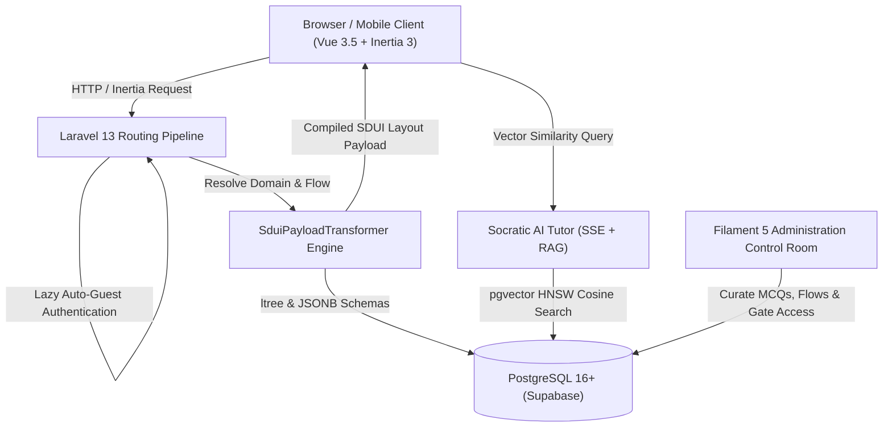

# Pak-All-Tests 🇵🇰

> **Next-Generation Dynamic EdTech Monolith & AI Mentorship Engine for Pakistani Competitive Examinations**  
> Architected with Laravel 13 • Inertia 3 • Vue 3.5 • Tailwind CSS 4 • PostgreSQL 16+ (`ltree` & `pgvector`) • Filament 5

---

## 🧭 Executive Overview

**Pak-All-Tests** solves the *Specialized Generalist Paradox* in competitive examination preparation. Historically, edtech in Pakistan has been fragmented into static, single-vertical applications (medical college entrance vs. civil service vs. armed forces) or generic video-hosting platforms.

Pak-All-Tests operates as a **unified, centralized backend monolith** while delivering **hyper-specialized, bespoke, and adaptive learning experiences** on the frontend through **Server-Driven User Interface (SDUI)** architecture. 

A candidate preparing for the **Pakistan Military Academy (PMA) Long Course** or **GD Pilot** receives a sequential gating workflow: rapid-fire Verbal & Non-Verbal Intelligence screening tests, followed by academic testing, medical standards, and Inter Services Selection Board (ISSB) psychological preparation. In contrast, a **CSS (Central Superior Services)** aspirant receives an analytical curriculum focused on syllabus subject grids, subjective prompt evaluations, and Socratic AI mentoring.

---

## ⚡ Core Architectural Capabilities



1. **Server-Driven UI (SDUI) Engine**:
   - Layouts, phase steps, test modes, and interactive widgets are dictated by dynamic JSON schemas compiled server-side by `SduiPayloadTransformer`.
   - Adding new competitive exam domains (e.g. ECAT, PPSC, or international entry exams) requires zero frontend deployments; administrators configure the layout hierarchy directly in Filament.
2. **PostgreSQL `ltree` & `pgvector` Monolith**:
   - Uses PostgreSQL `ltree` for sub-millisecond querying of deeply nested category hierarchies (`ArmedForces.Army.PMA.LongCourse`).
   - Uses `pgvector` with 1536-dimensional HNSW vector embeddings stored alongside relational data, powering domain-isolated RAG without external vector database bloat.
3. **Frictionless Candidate Onboarding**:
   - **Instant 24-Hour Guest Pass**: Direct URL visits seamlessly provision an ephemeral guest account via `AutoAuthenticateGuest` middleware with full platform access on the initial HTTP request (zero login barriers or redirects).
   - **7-Day Free Trial & Non-Destructive Conversion**: Guests can convert into permanent accounts at any time, preserving 100% of their test history and weak-question mastery logs.
   - **Viral Referral Ladder**: Multi-tier referral engine granting parents and candidates +7 days per referral and 30 days of full platform access upon reaching milestone targets.
4. **Socratic AI Exam Mentor**:
   - Real-time Server-Sent Events (SSE) streaming chat drawer with Roman Urdu and bilingual support.
   - **Zero-Knowledge Security Law**: AI prompts dynamically strip correct answer keys, preventing exam leaks while guiding students toward conceptual understanding.
   - **Viewport Synchronization**: Draggable floating action button (FAB) that tracks active question and pagination viewports (Page View vs. Focus Mode).
5. **SenseLab Luxury Design System**:
   - Tailored aesthetic with dark/light theme tokens, glassmorphic headers, nested radius harmony ($R_{\text{inner}} = \max(0, R_{\text{outer}} - P)$), and tactile interactive controls.

---

## 🛠️ Technology Stack & Runtime Specifications

| Layer | Technology | Version / Configuration | Role in Architecture |
| :--- | :--- | :--- | :--- |
| **Backend Monolith** | [Laravel](https://laravel.com/) | `^13.17` (PHP `^8.3` / `8.4`) | Strict typing, Form Requests, Services, Events, Queues |
| **Frontend Framework** | [Vue.js](https://vuejs.org/) | `^3.5.13` (Composition API) | Pure JavaScript `<script setup>`, reactive components |
| **Client-Server Bridge** | [Inertia.js](https://inertiajs.com/) | `^3.0.0` (`@inertiajs/vue3`) | Modern monolith architecture; zero REST/GraphQL boilerplate |
| **Styling & Theme** | [Tailwind CSS 4](https://tailwindcss.com/) | `@tailwindcss/vite: ^4.1.11` | Pure CSS theme variables, fluid responsive layouts |
| **Admin Control Room** | [Filament](https://filamentphp.com/) | `^5.0` (`filament/filament`) | Resource management, JSON schema builder, payment review |
| **Database Engine** | [PostgreSQL](https://www.postgresql.org/) | `16+` (Supabase / RDS) | `ltree` category paths, `pgvector` 1536-dim embeddings |
| **Authentication** | [Laravel Fortify](https://laravel.com/docs/fortify) | `^1.37.2` • Passkeys | WebAuthn Passkeys, 2FA, session-based auth, Team tenancy |
| **UI Primitives** | [Reka UI](https://reka-ui.com/) & Lucide | `reka-ui: ^2.9.8` • `@lucide/vue` | Headless accessible components (Radix primitives) |
| **Test Suite** | [Pest](https://pestphp.com/) | `pestphp/pest: ^4.7` | Feature & unit test suite with `DatabaseTransactions` |
| **Static Analysis** | [Larastan](https://github.com/larastan/larastan) | `^3.9` (PHPStan Level 6) | Compilation integrity & type contract verification |
| **Code Formatting** | [Laravel Pint](https://laravel.com/docs/pint) | `^1.27` (`preset: "laravel"`) | Enforced code formatting standard across all files |

---

## 📂 System Directory Layout

```
Pak-All-Tests/
├── .agent/                             # Autonomous governance, architecture & memory logs
│   ├── ARCHITECTURE.md                 # Complete reverse-engineered system blueprint
│   ├── MEMORY.md                       # Rolling project memory log & environment fixes
│   ├── SYSTEM_RULES.md                 # Core engineering laws & senior architect mandate
│   └── rules/                          # Domain rulebook (domains, sdui, security, ai, qa)
├── app/
│   ├── Actions/                        # Single-purpose actions (Fortify, Teams, QuestionBank)
│   ├── Enums/                          # Strict PHP enums (SubscriptionStatus, TeamRole, etc.)
│   ├── Filament/                       # Filament 5 Admin Panel resources, tables & schemas
│   ├── Http/
│   │   ├── Controllers/                # Thin controllers delegating to domain services
│   │   └── Middleware/                 # AutoAuthenticateGuest, CaptureReferralCode, etc.
│   ├── Models/                         # Eloquent Models (Domain, QuestionBank, User, etc.)
│   └── Services/                       # Domain logic services:
│       ├── Ai/                         # AiTutorService, AiCompletionService (SSE streaming)
│       ├── GuestAuthService.php        # Ephemeral 24h guest pass provisioning & conversion
│       ├── ReferralService.php         # Viral referral rewards ladder & anti-abuse engine
│       ├── SduiPayloadTransformer.php  # Server-Driven UI layout compiler
│       └── SubscriptionManager.php     # Payment gating, trials, manual review & expiry
├── database/
│   ├── factories/                      # Model factories for Pest test fixtures
│   ├── migrations/                     # PostgreSQL schema definitions with ltree & vector
│   └── seeders/                        # PlatformSeeder, QuestionBankSeeder, DomainSeeder
├── resources/
│   ├── css/app.css                     # Tailwind CSS 4 theme variables & design tokens
│   └── js/
│       ├── components/
│       │   ├── ai/AiTutorWidget.vue    # Draggable floating Socratic AI Mentor
│       │   ├── referral/ReferralCard.vue # Viral referral link & rewards widget
│       │   └── sdui/                   # SDUI Component Catalog:
│       │       ├── SduiRenderer.vue    # Recursive layout & node compiler
│       │       ├── McqPlayer.vue       # Timed exam player (Page View & Focus Mode)
│       │       ├── StudyQaPlayer.vue   # Non-evaluative criteria & study Q&A reader
│       │       ├── PhaseStepperLayout.vue # Pipeline stepper for multi-stage exams
│       │       └── SubjectGrid.vue     # Dynamic syllabus subject tiles
│       └── pages/                      # Inertia page templates (Domain/Dashboard, etc.)
├── routes/
│   ├── web.php                         # Student learning & guest candidate route definitions
│   ├── settings.php                    # Candidate account, profile & security settings
│   └── console.php                     # Scheduled commands (e.g. subscriptions:expire-lapsed)
└── tests/
    ├── Feature/                        # Pest feature test suites (200+ tests)
    └── Unit/                           # Unit tests for domain models & transformers
```

---

## 🚀 Local Development Setup

### 1. Prerequisites
- **PHP**: `^8.3` or `8.4` with extensions: `pdo_pgsql`, `mbstring`, `bcmath`, `curl`, `intl`, `zip`
- **Composer**: `^2.7`
- **Node.js**: `^20.x` or `^22.x` & `npm` / `pnpm`
- **PostgreSQL**: `16+` with `ltree` and `vector` extensions enabled (Supabase recommended)

### 2. Installation Steps

1. **Clone the repository**:
   ```bash
   git clone https://github.com/MuhammadDevPk/Pak-All-Tests.git
   cd Pak-All-Tests
   ```

2. **Install PHP and Node dependencies**:
   ```bash
   composer install
   npm install
   ```

3. **Configure Environment**:
   ```bash
   cp .env.example .env
   php artisan key:generate
   ```

4. **Configure Database & PostgreSQL Extensions**:
   Update `.env` with your PostgreSQL connection credentials:
   ```env
   DB_CONNECTION=pgsql
   DB_HOST=127.0.0.1
   DB_PORT=5432
   DB_DATABASE=pak_all_tests
   DB_USERNAME=postgres
   DB_PASSWORD=your_password
   ```

   Ensure PostgreSQL has the required extensions enabled:
   ```sql
   CREATE EXTENSION IF NOT EXISTS "uuid-ossp";
   CREATE EXTENSION IF NOT EXISTS "ltree";
   CREATE EXTENSION IF NOT EXISTS "vector";
   ```

5. **Run Database Migrations & Seeders**:
   ```bash
   php artisan migrate --seed
   ```
   *This provisions default admin accounts, initial exam domains (PMA Long Course, CSS, GD Pilot), content modules, and question banks.*

6. **Build Frontend Assets & Start Development Server**:
   ```bash
   # Terminal 1: Vite dev server with Hot Module Replacement (HMR)
   npm run dev

   # Terminal 2: Laravel local web server
   php artisan serve
   ```
   Open your browser at **`http://localhost:8000`**.

---

## 🏛️ Server-Driven UI (SDUI) Architecture

Pak-All-Tests decouples frontend rendering from hardcoded routes. Instead of static templates, the server dynamically generates a UI node tree:

```json
{
  "type": "PhaseStepperLayout",
  "props": {
    "phases": [
      {
        "id": "intelligence",
        "title": "Intelligence Screening",
        "content": [
          {
            "type": "SubjectGrid",
            "props": {
              "title": "Verbal & Non-Verbal Screening",
              "moduleQuery": { "module_type": "mcq_test", "limit": 6 }
            }
          }
        ]
      },
      {
        "id": "physical",
        "title": "Physical Standards",
        "content": [
          {
            "type": "SubjectGrid",
            "props": {
              "title": "Physical Screening Criteria",
              "moduleQuery": { "dashboard_section": "physical", "limit": 10 }
            }
          }
        ]
      }
    ]
  }
}
```

The frontend resolves these layouts via [`SduiRenderer.vue`](file:///resources/js/components/sdui/SduiRenderer.vue) and [`componentRegistry.js`](file:///resources/js/components/sdui/componentRegistry.js), guaranteeing instant layout flexibility without frontend redeployments.

---

## 🤖 Socratic AI Exam Mentor & Zero-Knowledge Security

The embedded Socratic AI Mentor (`AiTutorWidget.vue`) operates under strict institutional pedagogical guidelines:

- **Context-Aware RAG**: Computes query embeddings and executes cosine similarity searches (`<=>`) over `domain_knowledge_embeddings` scoped strictly to the candidate's active `domain_id`.
- **Zero-Knowledge Answer Security**: MCQ correct answer indices (`correct_option_index`) and solution letters are scrubbed before payloads are injected into the prompt context, preventing students from manipulating the mentor into revealing direct answers.
- **Socratic Instruction**: Questions are answered with guided Socratic hints, conceptual explanations, and Roman Urdu linguistic adaptation.
- **Real-Time SSE Streaming**: Emits live token streams via HTTP `text/event-stream` with client-side auto-reconnection and heartbeat pinging.

---

## 🛡️ Candidate Access & Monetization Flow

1. **Instant Guest Pass**: Visitors navigating to `/d/{domainSlug}` or `/dashboard` are immediately authenticated by [`AutoAuthenticateGuest`](file:///app/Http/Middleware/AutoAuthenticateGuest.php) and granted 24 hours of trial access.
2. **Subscription State Machine**:
   - `pending` $\rightarrow$ Candidate submits JazzCash / EasyPaisa / Bank transfer receipt (`/subscription/receipt`).
   - `active` $\rightarrow$ Administrator verifies the transaction in the Filament panel, unlocking platform access.
   - `rejected` $\rightarrow$ Ineligible or unreadable receipts are recorded with a reason code.
   - `expired` $\rightarrow$ Automated atomic cron batching (`php artisan subscriptions:expire-lapsed`) gracefully cycles expired trials.
3. **Administrative Master Switches**: 1-click toggles in `PlatformSetting` allow administrators to bypass payment gating globally (`all_domains_free`) or toggle auto-guest onboarding (`auto_guest_login`) during high-traffic marketing campaigns.

---

## 🧪 Testing, Quality Assurance & CI Validation

The codebase maintains strict quality gates with comprehensive automated testing and forensic line-by-line review standards:

```bash
# 1. Run full automated Pest test suite
./vendor/bin/pest

# 2. Run PHPStan static analysis (Level 6)
./vendor/bin/phpstan analyse

# 3. Verify Laravel Pint code formatting
./vendor/bin/pint --dirty --test

# 4. Compile production frontend bundle
npm run build
```

---

## 📄 License & Governance

Pak-All-Tests is proprietary software engineered for the Pakistani educational and competitive examination market.  
Autonomous agents and developers contributing to this repository must follow the mandatory governance protocols defined in [`AGENTS.md`](file:///AGENTS.md) and [`.agent/SYSTEM_RULES.md`](file:///.agent/SYSTEM_RULES.md).
